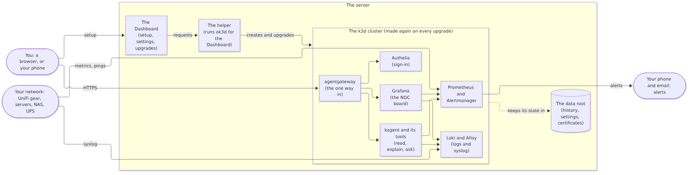

# How ok3d fits together

ok3d watches your home network from one server. This page shows its pieces and how you set
it up. [PLAN.md](../PLAN.md) has every decision and the reasons for it, and the roadmap
says which release brings each piece.

## The pieces

<picture>
  <source media="(prefers-color-scheme: dark)" srcset="../images/diagrams/overview-dark.png">
  
</picture>

- **The Dashboard and the helper** run on the server itself, outside the cluster. The
  Dashboard is where you set ok3d up and change it; the helper runs the `ok3d` command for
  it. They stay up when the cluster is down, which is when you need them.
- **The cluster** is a k3d cluster with one node. It's made again from scratch on every
  upgrade, so it never drifts from what the release says it should be.
- **The data root** is a folder on the server that holds everything worth keeping:
  Prometheus's history, Grafana's database, the certificate authority, and more. A new
  cluster picks up where the old one left off.
- **agentgateway** is the one way into the cluster's web pages, over HTTPS, behind a
  sign-in through Authelia.

## Setting it up

<picture>
  <source media="(prefers-color-scheme: dark)" srcset="../images/diagrams/setup-flow-dark.png">
  
</picture>

Until the Dashboard arrives in 0.5, the same steps run in a terminal: copy
`settings.example.yaml` to `settings.yaml`, then `./ok3d check` and `./ok3d apply`.

## The diagrams

Each diagram starts as a Mermaid file in [docs/diagrams/](diagrams/). After changing one,
run `scripts/diagrams.sh` to render its light and dark images again.
