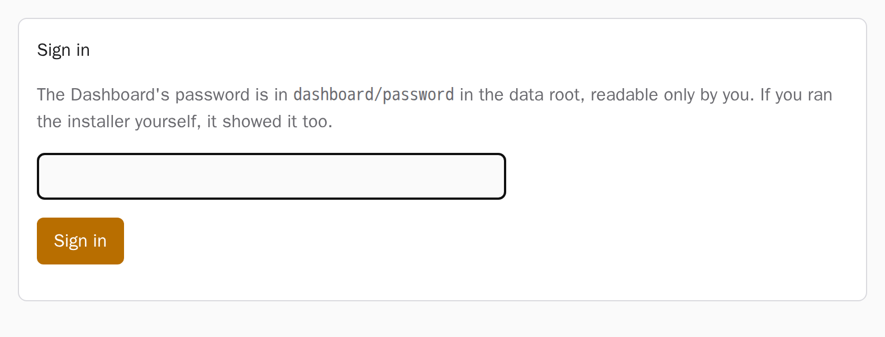
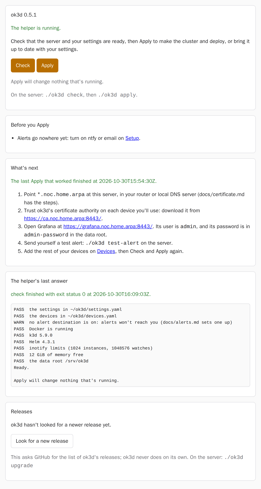
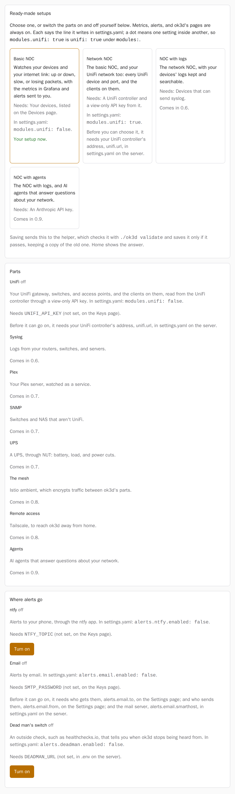
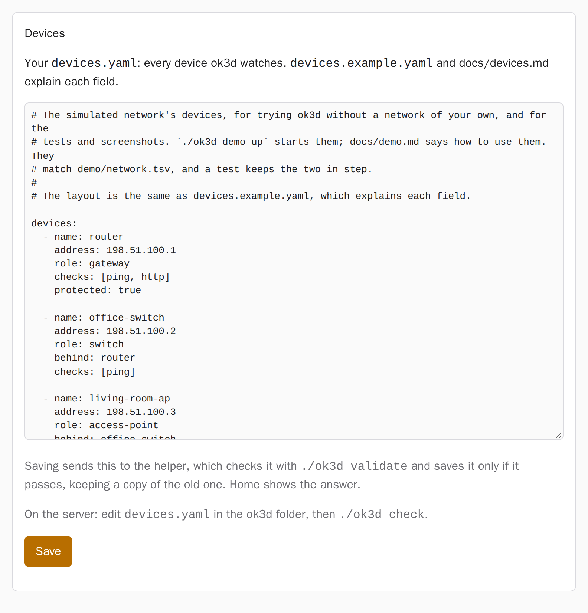
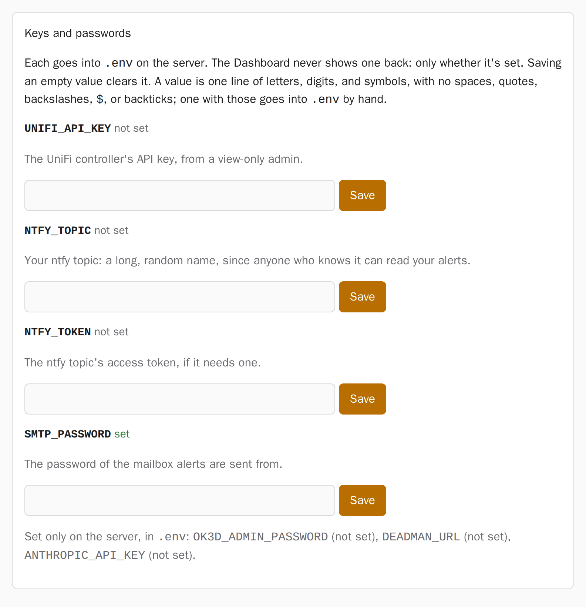
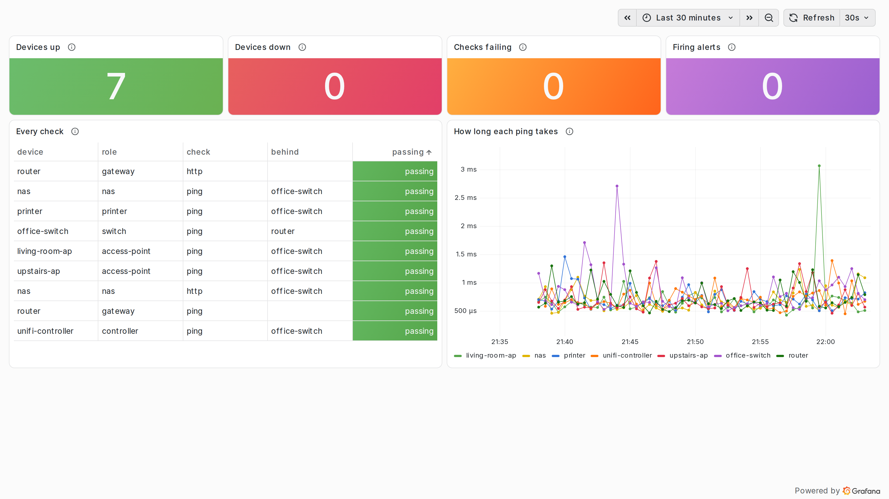

# Setting up ok3d from the Dashboard

From 0.5, you set ok3d up on a web page, the Dashboard, instead of editing files and running
commands. The installer starts it, and gives you its address and password.
[The Dashboard under the hood](dashboard-under-the-hood.md) says how it works and what keeps
it safe.

## Install

On the server, as yourself (not root), with Docker, k3d, Helm, and `kubectl` installed:

```sh
sudo install -d -o "$USER" -m 0755 /srv/ok3d   # the data folder, owned by you
curl -fsSL https://raw.githubusercontent.com/southsidedean/observability-k3d/main/install.sh | sh
```

The installer puts ok3d in `~/ok3d`, makes your `settings.yaml`, starts the Dashboard, and
prints its address, `https://dashboard.noc.home.arpa:8444/` with the example settings, and
its password. To open it, point `dashboard.noc.home.arpa` (or every name under your domain)
at the server, and trust ok3d's certificate authority on your computer:
[Opening ok3d's pages](certificate.md) has the steps for both.

## Sign in

<picture>
  <source media="(prefers-color-scheme: dark)" srcset="../images/screenshots/dashboard-sign-in-dark.png">
  
</picture>

The password is the one the installer printed. It's also in `dashboard/password` in the data
root, readable only by you. After five wrong tries from one computer, sign-in pauses for a
minute.

## Home

<picture>
  <source media="(prefers-color-scheme: dark)" srcset="../images/screenshots/dashboard-home-dark.png">
  
</picture>

Home is where you start and finish each change:

1. **Before you Apply** lists what's still missing: a key a part you switched on needs,
   somewhere for alerts to go, or devices to watch.
2. **Check** asks the server whether it's ready and your settings are valid. It changes
   nothing. Its answer appears under **The helper's last answer**: reload the page to see it
   arrive.
3. **Apply** turns on once a Check finds no problems. The first Apply makes the cluster and
   takes about 20 minutes; later ones bring it up to date with your settings, and are
   quicker.
4. **What's next** appears once an Apply has worked: the steps on your own devices that the
   Dashboard can't do for you, such as trusting the certificate authority and opening
   Grafana.

## Setup

<picture>
  <source media="(prefers-color-scheme: dark)" srcset="../images/screenshots/dashboard-setup-dark.png">
  
</picture>

Choose a ready-made setup, or switch the parts on and off yourself:

- **Basic NOC** watches your devices and your internet link.
- **Network NOC** adds your UniFi network. It needs your UniFi controller's address in
  `settings.yaml` on the server (`unifi.url`) and a view-only API key on the Keys page.
  [Your devices](devices.md#unifi) says how to make the key.
- **Where alerts go**: ntfy, email, and the dead man's switch. Each says which keys it needs.
  [Alerts](alerts.md) has the steps for each.

Each choice is saved to `settings.yaml`, and then Home shows the answer. A part that comes in
a later release says which one.

## Settings and Devices

<picture>
  <source media="(prefers-color-scheme: dark)" srcset="../images/screenshots/dashboard-devices-dark.png">
  
</picture>

These show `settings.yaml` and `devices.yaml` as they are on the server, to change and save.
`settings.example.yaml` explains every setting, and [Your devices](devices.md) every field
of a device. A save is checked first and refused if anything's wrong, and the old file is
kept in `local/backups/` on the server. Some settings decide where ok3d keeps its data and
where it sends your keys; a save that changes those is refused, and you change them in the
file on the server.

## Keys

<picture>
  <source media="(prefers-color-scheme: dark)" srcset="../images/screenshots/dashboard-keys-dark.png">
  
</picture>

Keys and passwords go into `.env` on the server. The Dashboard shows only whether each one is
set, never its value. Saving an empty value clears it. The admin password, the dead man's
switch's address, and the Anthropic API key are set only in `.env` on the server.

## Grafana

<picture>
  <source media="(prefers-color-scheme: dark)" srcset="../images/screenshots/grafana-devices-dark.png">
  
</picture>

Once an Apply has worked, Grafana is at `https://grafana.noc.home.arpa:8443/` with the
example settings. Sign in as `admin`, with the password in `admin-password` in the data
root. The **ok3d: Devices** dashboard shows every device and check.
